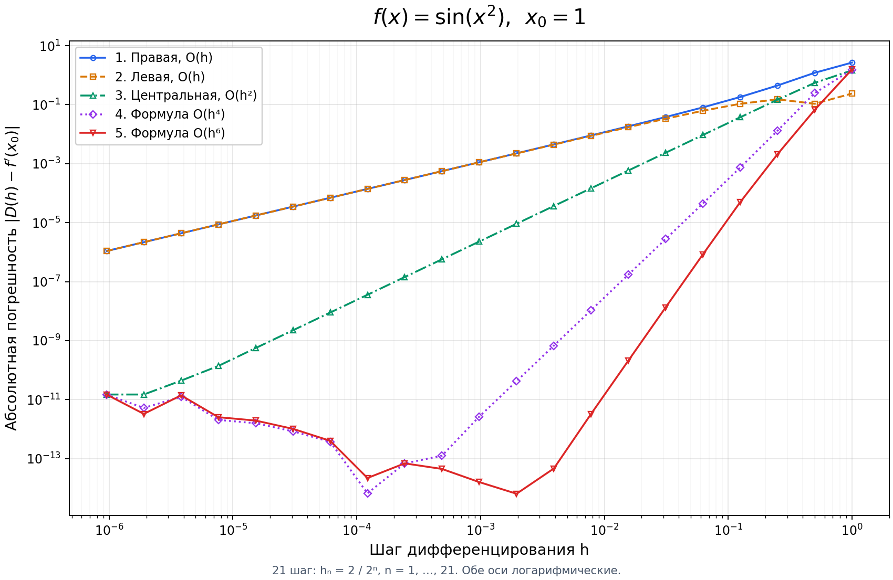
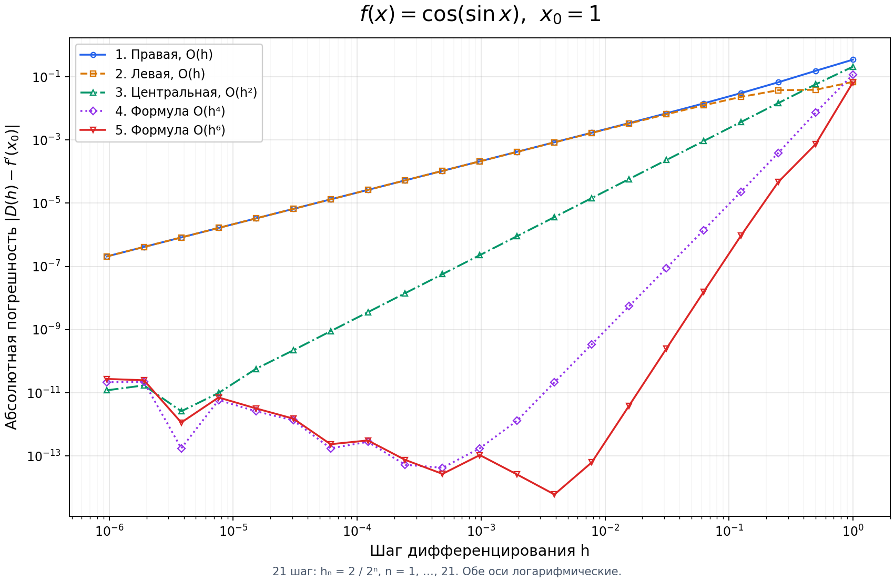
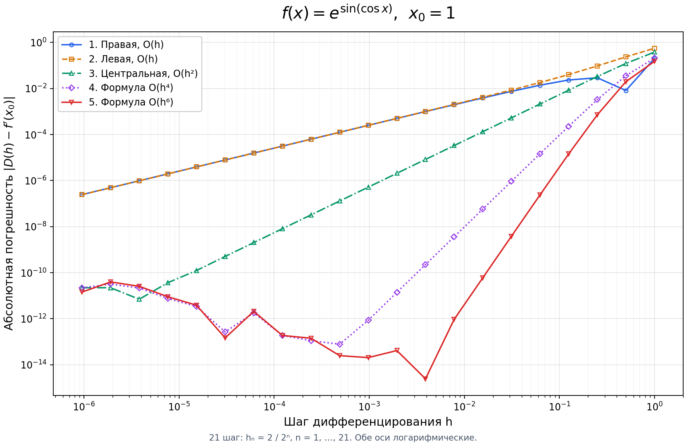
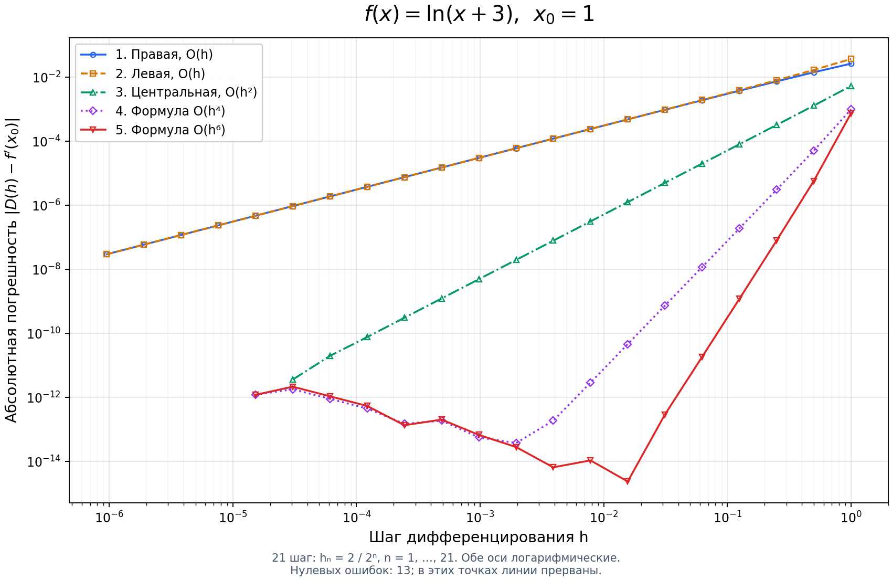
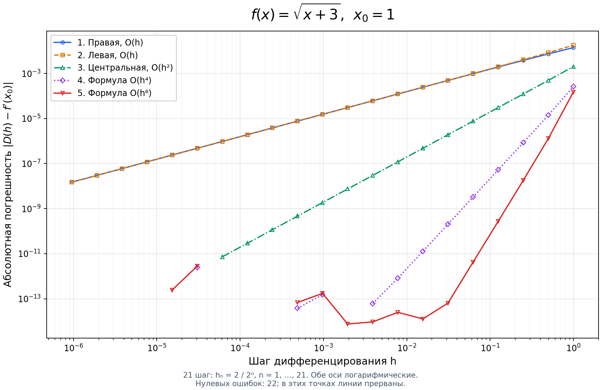

# Лабораторная работа № 1. Численное дифференцирование

Сравнение пяти формул приближённого вычисления первой производной.
Для каждой из пяти функций строится отдельный график абсолютной погрешности
от шага: **5 рисунков, по 5 кривых, обе оси логарифмические**.

Готовые графики и таблицы лежат рядом с кодом. Папки создавать не нужно.

## Запуск

Нужен Python 3.10 или новее. Команды выполняются в папке проекта.

```bash
python -m venv .venv
```

Активация окружения в Windows PowerShell:

```powershell
.venv\Scripts\Activate.ps1
```

В Windows CMD:

```bat
.venv\Scripts\activate.bat
```

В macOS / Linux:

```bash
source .venv/bin/activate
```

Установка зависимости и расчёт:

```bash
python -m pip install -r requirements.txt
python main.py
```

Если команда `python` не найдена, используйте `python3` (macOS / Linux)
или `py` (Windows). По умолчанию графики сохраняются в PNG без открытия окон.
Чтобы открыть все пять рисунков в отдельных окнах на компьютере с графическим интерфейсом:

```bash
python main.py --show
```

## Условие и выбранная точка

Используются шаги

$$h_n=\frac{2}{2^n},\qquad n=1,\ldots,21.$$

Первый шаг равен 1, последний — $2^{-20}\approx9.536743\cdot10^{-7}$.
Диапазон шагов не расширялся относительно задания.

В предоставленном условии точка дифференцирования не указана.
В этой реализации **принято $x_0=1$**. Это самостоятельный выбор,
а не дополнительное требование преподавателя.

| № | Функция $f(x)$ | Аналитическая производная $f'(x)$ |
|---|---|---|
| 1 | $\sin(x^2)$ | $2x\cos(x^2)$ |
| 2 | $\cos(\sin x)$ | $-\sin(\sin x)\cos x$ |
| 3 | $e^{\sin(\cos x)}$ | $-e^{\sin(\cos x)}\cos(\cos x)\sin x$ |
| 4 | $\ln(x+3)$ | $1/(x+3)$ |
| 5 | $\sqrt{x+3}$ | $1/(2\sqrt{x+3})$ |

Точку можно изменить, сохранив отдельный набор результатов:

```bash
python main.py --x0 0.7 --output results_x07
```

Для полного эксперимента требуется $x_0>0$: пятая формула обращается
к $f(x_0-3h)$, а при $h=1$ аргумент логарифма равен $x_0$.
В частности, $x_0=0$ нельзя использовать со всем заданным набором шагов.

## Формулы

Все пять формул вычисляют **первую производную**.
Числа 4 и 6 обозначают порядок точности, а не порядок производной.

Правая разность:

$$D_1(h)=\frac{f(x_0+h)-f(x_0)}h.$$

Левая разность:

$$D_2(h)=\frac{f(x_0)-f(x_0-h)}h.$$

Центральная разность:

$$D_3(h)=\frac{f(x_0+h)-f(x_0-h)}{2h}.$$

Четвёртая формула:

$$D_4(h)=\frac43\frac{f(x_0+h)-f(x_0-h)}{2h}-\frac13\frac{f(x_0+2h)-f(x_0-2h)}{4h}.$$

Пятая формула:

$$D_5(h)=\frac32\frac{f(x_0+h)-f(x_0-h)}{2h}-\frac35\frac{f(x_0+2h)-f(x_0-2h)}{4h}+\frac1{10}\frac{f(x_0+3h)-f(x_0-3h)}{6h}.$$

В коде последние две формулы записаны через `central(f, x, h)`.
Это те же выражения: `central(f, x, 2*h)` уже содержит знаменатель $4h$,
а `central(f, x, 3*h)` — знаменатель $6h$.

Для каждой формулы и каждого шага считается абсолютная погрешность:

$$E_j(h)=|D_j(h)-f'(x_0)|.$$

Эталонная производная вычисляется непосредственно по аналитической формуле.
Вызовы готовых численных дифференциаторов не используются.

## Откуда берутся порядки точности

Из разложения Тейлора:

$$f(x+h)=f(x)+hf'(x)+\frac{h^2}{2}f''(x)+\frac{h^3}{6}f'''(x)+\cdots.$$

После подстановки в односторонние формулы первый член ошибки пропорционален $h$:

$$D_1(h)=f'(x)+\frac h2 f''(x)+O(h^2),\qquad D_2(h)=f'(x)-\frac h2 f''(x)+O(h^2).$$

В центральной разности чётные степени исходного ряда сокращаются:

$$D_3(h)=f'(x)+\frac{h^2}{6}f'''(x)+\frac{h^4}{120}f^{(5)}(x)+O(h^6).$$

В четвёртой формуле коэффициент при $h^2$ равен
$4/3-(1/3)\cdot2^2=0$, поэтому остаётся погрешность $O(h^4)$.

В пятой формуле сумма весов равна 1, а коэффициенты при $h^2$ и $h^4$ равны нулю:

$$\frac32-\frac35+\frac1{10}=1,$$

$$\frac32-\frac35\cdot2^2+\frac1{10}\cdot3^2=0,$$

$$\frac32-\frac35\cdot2^4+\frac1{10}\cdot3^4=0.$$

Первый оставшийся член имеет порядок $h^6$.
Итак, порядки пяти формул: **1, 1, 2, 4, 6**.

## Результаты

Графики ниже получены при $x_0=1$.
На каждом рисунке шаг возрастает слева направо:
чтобы проследить уменьшение шага, нужно двигаться **справа налево**.
Кривые первой и второй формул при небольших шагах почти совпадают;
для различения использованы разные маркеры и типы линий.











Таблица минимальных ошибок и соответствующих шагов:
[summary.md](summary.md).

Каждый CSV содержит 21 строку данных и столбцы:

| Столбец | Содержание |
|---|---|
| `n` | Номер шага от 1 до 21 |
| `h` | Шаг $2/2^n$ |
| `x0` | Точка дифференцирования |
| `reference_derivative` | Значение аналитической производной |
| `D1`–`D5` | Пять приближений производной |
| `error1`–`error5` | Соответствующие абсолютные погрешности |

### Нулевые погрешности

Для логарифма и корня в выбранной точке эталонная производная равна 0.25.
При некоторых шагах приближение совпадает с этим числом в арифметике `float`,
и вычисленная ошибка равна нулю. Это не означает точность формулы
в вещественной арифметике.

Логарифм нуля не определён. Поэтому нули **сохраняются в CSV**, но на графике
в этих местах делается разрыв. Они не заменяются искусственно малой ошибкой.
Количество таких точек указано под рисунком и в итоговой таблице.

### Выводы

1. На участке, где преобладает ошибка усечения, высокие порядки дают более
   быстрое уменьшение погрешности при уменьшении шага. На log-log графике
   зависимость $E\approx Ch^p$ выглядит как прямая с наклоном $p$.
2. При слишком малых шагах вычитаются близкие числа и ошибки округления
   усиливаются делением на $h$. Грубая модель суммарной ошибки:
   $E(h)\approx C_1h^p+C_2\varepsilon_{\mathrm{mach}}/h$.
   Меньший шаг поэтому не всегда означает меньшую погрешность.
3. Например, в приложенном расчёте для $\sin(x^2)$ формула 5 при
   $h=2^{-9}$ дала ошибку около $6.44\cdot10^{-15}$,
   а при наименьшем шаге $h=2^{-20}$ — около $1.49\cdot10^{-11}$.
4. Для односторонних формул на заданном диапазоне уменьшение шага в целом
   продолжает улучшать результат. Минимум ошибки не обязан оказаться внутри
   выбранного диапазона для каждой кривой.
5. Для логарифма и корня часть ошибок совпала с нулём в машинной арифметике.
   Такие точки нужно отличать от доказанного отсутствия погрешности.

Последние разряды, положение отдельных минимумов и число совпадений с нулём
могут различаться между платформами из-за реализации математических функций.

## Структура проекта

| Путь | Назначение |
|---|---|
| `main.py` | Функции, пять методов, расчёт, графики и экспорт |
| `requirements.txt` | Зависимость для построения графиков |
| `test_methods.py` | Проверки формул и численного эксперимента |
| `*.png` | Пять готовых графиков |
| `*.csv` | Полные таблицы результатов |
| `summary.md` | Автоматически формируемая сводка |
| `.gitignore` | Исключения для временных файлов и окружения |

## Проверка

```bash
python -m unittest test_methods -v
```

Проверяются заданные шаги, точность на полиномах, порядки сходимости на $e^x$,
аналитические производные и наличие конечных неотрицательных ошибок.

## Загрузка на GitHub

1. Распакуйте архив проекта.
2. Создайте на GitHub пустой репозиторий, например `numerical-differentiation-lab`.
3. Через **uploading an existing file** или **Add file → Upload files**
   загрузите содержимое папки проекта, положив все файлы в корень репозитория.
4. В корне репозитория должны оказаться `main.py`, `README.md`, `requirements.txt`,
   `test_methods.py`, пять PNG, пять CSV и `summary.md`.
5. Не загружайте `.venv` и `__pycache__`. Все файлы можно выбрать вместе:
   README ссылается на графики в корне.

Альтернатива через Git (в папке проекта):

```bash
git init
git add .
git commit -m "Add numerical differentiation lab"
git branch -M main
git remote add origin https://github.com/YOUR_USERNAME/numerical-differentiation-lab.git
git push -u origin main
```

Замените `YOUR_USERNAME` на свой логин. Команды рассчитаны на новый пустой
репозиторий; авторизация GitHub и установленный Git нужны только для загрузки.
